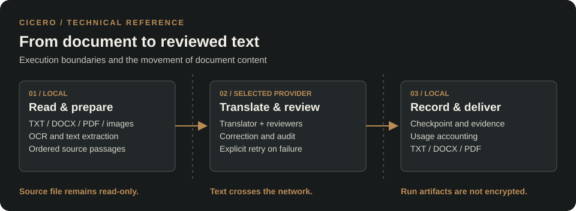
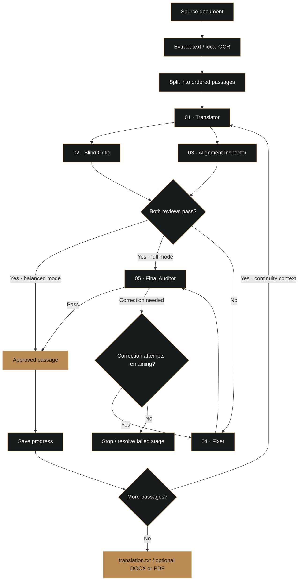
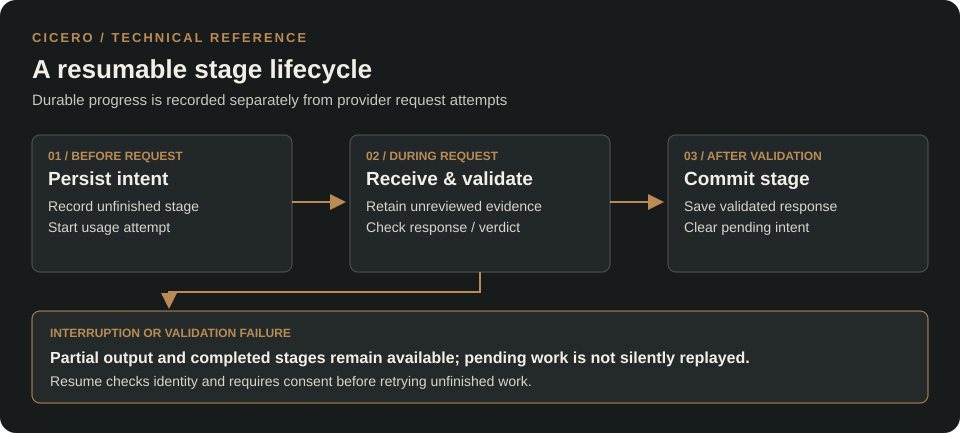

<div align="center">


### Translation, subjected to review.

**A model-agnostic document translation engine with independent criticism, alignment inspection, correction, and auditing.**


[Get started](#install-and-run-on-windows) · [Architecture](#how-a-run-works) · [Formats](#supported-documents) · [Providers](#providers) · [Privacy](#privacy) · [Troubleshooting](#troubleshooting) · [Tests](#development-and-tests)

</div>

---

## Overview

Cicero translates documents into readable plain text. It is an interactive Python
program: you pick a file, choose a target language and a model, and it produces a
UTF-8 text file. Translation does not preserve the source layout. Paragraph
counts, heading markers, and list markers may change, because Cicero formats the
text locally after translating it.

Each run saves its progress in a separate folder, so you can continue after a
stop, a crash, or a provider error.


### At a glance

| **01 / Read** | **02 / Translate** | **03 / Review** | **04 / Deliver** |
| :--- | :--- | :--- | :--- |
| TXT, DOCX, PDF and images; local OCR where needed. | Choose a provider and model for each role, or use one model throughout. | Independent fluency and meaning checks; correction and auditing when required. | UTF-8 text, optional DOCX/PDF, checkpoints and separate review records. |

> [!NOTE]
> Cicero is designed for readable, reviewed translations, not pixel-perfect document reproduction. Automated review reduces certain risks but does not guarantee translation accuracy.


<details>
<summary><strong>Documentation index</strong></summary>

| Using Cicero | Under the hood |
| --- | --- |
| [Requirements](#requirements) | [Passage size and reviewing](#passage-size-and-reviewing) |
| [Installation](#install-and-run-on-windows) | [Providers](#providers) |
| [Supported documents](#supported-documents) | [Token usage and balance](#token-usage-and-balance) |
| [Output files](#output-files) | [Privacy](#privacy) |
| [Resume](#resume) | [Limitations](#limitations) |
| [Development and tests](#development-and-tests) | [Evaluation](#evaluation) |

</details>

## Design principles

Cicero treats translation as a sequence of reviewable decisions rather than a single model response. The aim is to preserve meaning and produce natural target-language prose while keeping the source, intermediate evidence, final output, and billing information distinguishable.

| Principle | Implementation |
| --- | --- |
| **Separate linguistic responsibilities** | Blind Critic evaluates the target text; Alignment Inspector compares the source and draft. |
| **Control the inference configuration** | Choose one model or assign models per role, with explicit context and output budgets. |
| **Retain evidence** | Received responses, validated stages, reviewer notes and partial output have distinct records. |
| **Make failures visible** | Invalid verdicts, truncated responses and exhausted correction attempts are not approvals. |
| **Preserve user control** | Source files are read-only; uncertain stages require retry consent. |



Cicero is particularly suited to long-form prose where the readable translation is more important than recreating document geometry. A PDF containing elaborate tables, diagrams or a complex reading order still requires manual inspection. It is not a certified translation service, an offline inference engine, or a layout-preserving document editor.

## Requirements

- Python 3.11 or later.
- An API key for one of the supported providers.
- Tesseract, installed separately and on `PATH`, if you need OCR (scanned PDFs,
  images, or image-only DOCX). The Python wrapper is in `requirements.txt`, but
  the Tesseract program itself is not bundled.

## Install and run on Windows

1. Keep the files together in a writable folder.
2. Run `Install_Cicero.cmd` once. It creates a local `.venv` and installs the
   dependencies.
3. Run `Start_Cicero.cmd`. Choose a document and a target language.

To install and run manually:

```text
python -m pip install -r requirements.txt
python interactive_translator.py
```

The program asks for your API key at run time with a hidden prompt. Keys are
never written to disk. Provider charges apply to the account you use, including
the optional startup samples.

### Manual environment setup

The Windows launcher creates and uses a repository-local virtual environment. For a shell-driven installation, use a Python 3.11+ environment:

```bash
python -m venv .venv
```

Activate it using the command for your shell:

| Shell | Activation |
| --- | --- |
| Windows Command Prompt | `.venv\Scripts\activate.bat` |
| Windows PowerShell | `.\.venv\Scripts\Activate.ps1` |
| POSIX shell | `source .venv/bin/activate` |

```bash
python -m pip install -r requirements.txt
python interactive_translator.py
```

Install Tesseract separately if OCR is required. Verify that the executable and the desired language data are available:

```bash
tesseract --version
tesseract --list-langs
```

The shell commands describe a manual setup; the bundled launchers are Windows-specific. No other platform compatibility guarantee is implied.

### First translation

For a small digital document, select the file, choose the target language, keep standard settings, and select a model from a provider catalog. Run the optional startup samples if you want a preliminary check of the selected model configuration. Review the finished TXT and the review notes before relying on the output. For scanned material, use advanced settings to choose the OCR language corresponding to the **source** text, not the desired translation language.

## How a run works

1. A native file window opens. If it cannot, Cicero asks for a path.
2. You choose the target language and, in advanced mode, the passage size,
   reviewing mode, file-reading options, and token budgets.
3. You choose the models. One model can serve every role, or you can pick a model
   per role. A provider key is entered once per provider and server.
4. Cicero extracts the text, splits it into passages, and shows the passage
   count.
5. Startup checks run seven short samples across all five roles. You can skip
   them, and the reviews still run during translation.
6. Each passage is translated, reviewed, corrected when needed, and audited.
7. The finished text is saved as `translation.txt`. You can also export DOCX or
   PDF.


### Translation architecture



The two reviewers operate concurrently on the same draft; neither replaces the other. The diagram illustrates successful review decisions and the bounded correction path. Malformed or failed stages are never treated as approval.

### Roles

| Role | Job |
| --- | --- |
| Translator | Translates each source passage. |
| Blind Critic | Reads the translation on its own for naturalness and style. |
| Alignment Inspector | Compares source and translation for missing or changed meaning. |
| Fixer | Corrects the draft using the reviewers' findings. |
| Final Auditor | Checks the corrected draft for accuracy and fluency. |

### Concurrency

Within one passage, the Blind Critic and the Alignment Inspector run at the same
time, because they do not depend on each other. Passages themselves stay in
order, so each passage still receives the previous approved translation as
continuity context. The number of simultaneous provider calls is capped at ten.

### Review modes and request count

The roles are logical responsibilities, not necessarily five distinct models or five requests for every passage.

| Path | Model calls per passage | Breakdown |
| --- | ---: | --- |
| Balanced, both reviewers pass | 3 | Translation + 2 reviews |
| Full, both reviewers and initial audit pass | 4 | Translation + 2 reviews + audit |
| Balanced or full, initial reviewers request correction | 5 or 7 | 3 initial calls + 2 calls per correction round |
| Full, initial reviewers pass but initial audit requests correction | 6 or 8 | 4 initial calls + 2 calls per correction round |

These counts follow the implemented control flow, excluding optional startup samples, failed requests, retries, catalog requests and balance lookups. For a fresh run with 20 passages and no corrections, the baseline is **60 inference calls in balanced mode** or **80 in full mode**. Running the seven startup samples increases those illustrative counts to 67 or 87. Provider token charges cannot be inferred from call count alone.

### What each reviewer sees

| Input | Translator | Blind Critic | Alignment Inspector | Fixer | Final Auditor |
| --- | :---: | :---: | :---: | :---: | :---: |
| Current source passage | Yes | No | Yes | Yes | Yes |
| Current draft | No | Yes | Yes | Yes | Yes |
| Previous approved translation context, if enabled and available | Yes | Yes | Yes | Yes | Yes |
| Reviewer findings | No | No | No | Yes | No |

The Blind Critic is deliberately not shown the current source passage. It evaluates the translation on its own, with optional prior style context. This is complementary to source-aware alignment inspection; it is not evidence of statistical independence between model judgments.

### Response contracts

The translation and correction roles return plain text. The review roles must return one of the following forms:

```text
VERDICT: PASS
```

```text
VERDICT: FIX
<specific findings>
```

A FIX response must contain nonempty findings of at most 1,800 characters and cannot contain a second verdict. Malformed or contradictory responses fail validation. Translation validation also checks invalid control characters, unexpected wrappers, and extreme length differences. For passages with more than 120 source characters, the permitted whole-passage length ratio is 0.18–6. These are coarse checks, not proof of semantic completeness.

## Supported documents

- **TXT**: BOM and UTF detection, plus automatic legacy-encoding detection, with a
  source preview and a manual override.
- **DOCX**: paragraphs, headings, lists, table-cell text, footnotes, and endnotes.
  Formatting runs are joined before translation. Table geometry, repeating
  headers and footers, comments, charts, and embedded images are not
  reconstructed. An image-only DOCX uses local OCR in document image order.
- **PDF**: digital text in reading order, with best-effort headings. Sparse
  scanned pages use local OCR, which replaces the page's digital extraction so
  both copies are not appended.
- **PNG, JPEG, TIFF, WEBP**: local OCR, with multi-frame images read in order.

OCR uses Tesseract on your computer. Choose the source-language code in advanced
settings, for example `eng`, `rus`, or `eng+rus`. You can force OCR on every PDF
page. No cloud OCR account or upload is used. OCR accuracy depends on the scan.
Mixed digital and scanned pages, multi-column PDFs, and unusual heading styles
need checking.

### Input handling reference

| Source | Extraction path | What deserves manual review |
| --- | --- | --- |
| TXT | Encoding detection, or explicit encoding override | Garbled characters and unusual formatting |
| DOCX | Text blocks, table-cell text, footnotes and endnotes; OCR for image-only files | Layout, embedded illustrations and complex tables |
| PDF | Digital text, or page-level local OCR when necessary | Reading order, multi-column pages and scan quality |
| Image | Tesseract OCR | Recognition errors and source-language selection |

OCR requires Tesseract on PATH with the relevant language packs. Use forced PDF OCR when a document has an unusable digital text layer; it processes every page as an image and may be slower.

## Output files

Each run creates a folder under `translations/`, beside the program:

- `translation.txt`: the completed UTF-8 deliverable.
- `translation.partial.txt`: saved passages with explicit incomplete or
  unreviewed labels. Missing passages are marked, never silently skipped.
- `review-notes.txt`: the reviewers' findings, kept separate from the translation.
- `passage-...received.txt`: the text received from each role, saved before
  validation and labelled unreviewed. Startup evidence uses `sample-...`. A
  response that contains a configured API key is never saved.
- `checkpoint.json`: saved progress, settings, and stage results. No keys.
- `usage.json`: API-reported token counts per request attempt, kept across
  resumes. No keys, prompts, or response text.
- `usage-summary.txt`: token totals and the latest balance result, when available.
- `translation.docx`, `translation.pdf`: optional exports after completion.

The source file is only read, never modified. A new run gets a new folder.

### Anatomy of a run directory

The following is a schematic example, not a literal output listing. Names and stage counts vary by run.

```text
translations/
└── <timestamp>-<random-id>/
    ├── checkpoint.json
    ├── translation.partial.txt
    ├── review-notes.txt
    ├── passage-1-translation.received.txt
    ├── passage-1-fluency.received.txt
    ├── passage-1-accuracy.received.txt
    ├── passage-1-<stage>-<attempt-id>.received.txt
    ├── usage.json
    ├── usage-summary.txt
    ├── translation.txt             # on completion
    ├── translation.docx            # optional export
    └── translation.pdf             # optional export
```

Use the completed TXT as the primary deliverable. The partial file is explicitly marked incomplete, even when it contains reviewed passages. The received-text files are evidence, not validated translations. Optional sample evidence and checkpoint upgrade backups may also be present.

## Resume

Run the program again and select the same source. If a saved run exists, Cicero
offers to continue it and restores its language and model settings. You enter
keys again only if more inference is needed. Completed stages are reused.

When the source content, target language, models, chunk boundaries, settings, or
prompts do not match, Cicero refuses to reuse the checkpoint and says why.
Checkpoints written by earlier shipped versions are upgraded in place, with a
backup and completed stages retained. Keep one instance open per run.

### Recovery and checkpoint identity



The checkpoint identity includes the source SHA-256, language and settings, public role configuration, chunk-content hash, prompt hash, and implementation/chunking versions. Compatible upgrades retain earlier completed stages and create a backup; incompatible identities are rejected instead of reusing mismatched data.

Validated stage results are written to disk. Writes use a temporary file in the same directory, flush and fsync the file, and replace the destination. An OS-level lock prevents simultaneous use of the same run directory. These mechanisms improve recovery behavior but are not a backup strategy or a guarantee against every filesystem or hardware failure.

| Situation | Expected action |
| --- | --- |
| Provider error or truncated response | Inspect the error; retry only if appropriate. |
| Process interrupted during a stage | Resume the matching run and explicitly consent to retry the unfinished stage. |
| Two correction attempts fail review | Inspect partial output and findings; use human review or a separate model configuration. |
| Source or settings changed | Start a new run or restore the compatible configuration. |
| Checkpoint unreadable | Preserve the original files; the application will not silently overwrite the unreadable checkpoint. |

## Passage size and reviewing

The default reviewing mode is balanced: both reviewers run, and if both pass,
there is no final audit. Corrections are always audited, with at most two
correction attempts. Full mode adds an audit even when both initial reviews pass.
A failed or malformed review is never treated as approval.

The passage target is 8,000 estimated source tokens, not 8,000 characters. Cicero
uses this estimate for planning; it does not use the provider's exact tokenizer.
It reserves output space using a 2.5x expansion allowance plus
overhead, and checks request size in UTF-8 bytes. By default, the last 1,000
estimated tokens of the previous approved translation provide continuity
context. There is no whole-book memory or external glossary, so terminology can
drift over long documents.

Source input is capped at 200 MB, expanded DOCX at 500 MB, and extracted text at
20 million characters. Very large books should be split into volumes.

### Advanced configuration reference

| Setting | Default | Accepted range / values |
| --- | --- | --- |
| Target language | English | User-supplied language |
| Review thoroughness | Balanced | Balanced / full |
| Estimated source tokens per passage | 8,000 | 100–8,000 |
| Translation expansion allowance | 2.5 | 1–8 |
| Previous approved passage context | 1,000 estimated tokens | 0–8,000 |
| Model context budget | 32,768 | 8,192–1,000,000 in setup |
| Model output budget | 4,096 | 1,024–128,000 in setup |
| Response / OCR timeout | 180 s | 10–3,600 s |
| TXT encoding | Auto | Explicit encoding supported |
| OCR source language | eng | Installed Tesseract language code(s) |
| Force PDF OCR | No | Yes / no |

Model limits are user-configured application budgets, not guarantees that the provider supports those limits.

### How the passage ceiling is calculated

For each role, Cicero reserves context for instructions, replies, source/draft material and review findings. The actual estimated source-token ceiling is the minimum of:

- the configured source target;
- for Translator and Fixer, `int((output_limit - 512) / expansion)`;
- for every role, `int((context_limit - output_limit - 6000 - extra_context) / 8)`, where `extra_context = max(0, context_tokens - 1000) * 4`.

With default settings and identical default budgets across roles, the three candidate ceilings are 8,000, 1,433 and 2,834 estimated tokens. The effective ceiling is therefore **1,433**, not 8,000. Configurations that leave fewer than 100 estimated source tokens are rejected. Paragraph-aware splitting and the separate UTF-8 byte-budget guard further constrain requests.

The planning estimate counts approximately one token per three ASCII characters and one per non-ASCII character, then multiplies by 1.2 and rounds upward. Actual tokenization varies by model and language.

## Providers

Supported connections: Google, Anthropic, OpenAI, DeepSeek, Model Studio (Qwen),
Z.AI (GLM), OpenCode, and B.AI. The retired NVIDIA host is recognized only so
old checkpoints still resume.

Requests use a low temperature (0) for faithful, repeatable translation. Some
reasoning models ignore the temperature setting.

Cicero ships no model names, presets, or per-model token profiles. Models come
from the selected provider's catalog, or from an exact model ID you enter. A
catalog listing does not guarantee that the model supports document translation
or is available to your account. New selections use conservative operating
defaults of 32,768 context tokens and 4,096 output tokens; advanced settings let
you enter the model's documented limits. A key is never reused with a different
provider or server.

### Selecting models and endpoints

| Provider | Configuration identifier |
| --- | --- |
| Google | `google` |
| Anthropic | `anthropic` |
| OpenAI | `openai` |
| DeepSeek | `deepseek` |
| Model Studio / Qwen | `qwen` |
| Z.AI / GLM | `glm` |
| OpenCode | `opencode` |
| B.AI | `b.ai` |

Use the catalog to filter available model identifiers, or provide an exact API model ID when using custom selection. If the catalog is unavailable, direct model-ID entry remains available. Advanced setup supports custom HTTPS API base addresses, with explicit confirmation when selecting a custom destination on a different host. Model Studio additionally provides region/workspace setup.

Using one model for every role simplifies configuration. Assigning different models can diversify the review configuration, but no quality advantage is guaranteed. Keep token limits within the selected models' documented capacities.

## Token usage and balance

At completion or interruption, Cicero prints input, output, and total tokens, and
totals by provider, model, and role, using the counts returned by the API. If a
request fails and reports no counts, its usage is marked unknown, not zero. The
official DeepSeek connection can return the account's monetary balance when the
session ends. Other connections report that balance is unavailable through them.
An unavailable balance means Cicero cannot retrieve it through that connection;
it does not mean the balance is zero or that the provider has no billing API.

### Accounting semantics

`usage.json` is a per-attempt ledger, separate from the checkpoint. Attempts are recorded before the request outcome is known; returned usage is recorded before content validation. Consequently, a response can contribute to token totals even when its translation or review is later rejected. Unreported values remain unknown. An upgraded run may have incomplete historical accounting.

The summary reports available input, output and total token counts, along with how many attempts supplied them. Do not add the reported total to the input and output figures again. Actual billing, including the treatment of cached or reasoning tokens, depends on the provider.

## Privacy

> [!IMPORTANT]
> Translation requires sending text to your selected model provider. Local OCR does not make the entire translation process local.

The following describes the current implementation's data handling.

- The text of each passage, the review prompts, and the draft are sent to the
  provider and model you select. The provider's own terms and retention policy
  apply to that data.
- OCR runs locally with Tesseract. OCR images and text are not uploaded as part
  of OCR.
- Translations, checkpoints, received model text, review notes, and usage records
  are written to the run folder on your disk. They are not encrypted and are not
  deleted automatically. Remove the run folder yourself when you no longer need
  the documents.
- The source file is read only.
- API keys are entered with `getpass` and are not saved. Responses that would
  contain a configured key are rejected and not written.
- Error messages withhold raw provider response bodies and document text.
- The only balance lookup is the documented DeepSeek endpoint, using the existing
  credential.

If you translate confidential material, that material reaches the provider you
choose, and it stays in the run folder until you delete it.

## Limitations

- Translation quality depends on the selected model. Cicero does not guarantee a
  correct translation and cannot prove that nothing was omitted.
- Local checks reject empty output, extreme whole-passage length anomalies, added
  wrappers, and truncated responses. They cannot detect every omission or
  mistranslation. The reviewers compare the full source and draft, but automated
  review is not perfect.
- Paragraph counts and layout need not match the source.
- OCR quality depends on the scan and on Tesseract's language data.
- A failed stage can be retried, and a retry may incur another charge. There is
  no automatic replay and no skipped stage.

## Troubleshooting

| Symptom | What to check |
| --- | --- |
| Tesseract is missing or OCR fails | Executable on PATH, installed language data, source scan quality and timeout. |
| Characters appear corrupted | TXT preview and explicit source encoding override. |
| Model catalog unavailable | API credentials, server address, or exact model ID from provider documentation. |
| Insufficient passage budget | Documented model context/output limits, expansion allowance and prior-context setting. |
| Reply truncated or malformed | Output budget and model capabilities; inspect received evidence before retrying. |
| Translation never reaches completion | Review notes, partial output and the pending-stage status. |
| DOCX/PDF differs from original | Expected: Cicero exports translated prose rather than reconstructing source layout. |

When sharing a failure report, remove confidential document content, received responses and credentials. Include the affected stage, non-sensitive configuration details and the observable error.

## Development and tests

```text
python -m pip install -r requirements-dev.txt
python -m pytest -q --cov=interactive_translator --cov-branch --cov-report=term-missing
```

Tests are in `test_translator.py`, `test_reliability.py`, and `test_usage.py`.
They run offline: `conftest.py` blocks network access, and provider responses are
simulated. Installing dependencies needs internet access; running the tests does
not.

## Evaluation

`run_document_eval.py` and `run_bleu.py` are optional evaluation scripts. They
score a translation against a reference with SacreBLEU (chrF and BLEU). They need
the `sacrebleu` package and a parallel source/reference corpus that you supply,
plus a provider key. They make real provider requests and can incur charges. They
are not part of the translator and are not run by the test suite.

### Repository guide

| File | Purpose |
| --- | --- |
| [`interactive_translator.py`](interactive_translator.py) | Interactive setup, extraction, model transport, review pipeline, checkpoints and exports |
| [`Install_Cicero.cmd`](Install_Cicero.cmd) | Windows virtual environment and dependency installation |
| [`Start_Cicero.cmd`](Start_Cicero.cmd) | Windows application launcher |
| [`requirements.txt`](requirements.txt) | Runtime dependencies |
| [`requirements-dev.txt`](requirements-dev.txt) | Development and coverage dependencies |
| [`test_translator.py`](test_translator.py), [`test_reliability.py`](test_reliability.py), [`test_usage.py`](test_usage.py) | Offline test modules |
| [`run_document_eval.py`](run_document_eval.py), [`run_bleu.py`](run_bleu.py) | Optional reference-based evaluation |

Runtime dependencies cover HTTP transport (httpx), encoding detection (charset-normalizer), DOCX/XML handling (python-docx and lxml), PDF extraction (PyMuPDF), image handling (Pillow), and the Tesseract Python wrapper (pytesseract).

### Reproducing an evaluation

Inspect the scripts' available arguments before configuring a real evaluation:

```bash
python run_document_eval.py --help
python run_bleu.py --help
```

Supply aligned source/reference files and an exact model ID. The scripts use real provider requests and may incur charges. No measured BLEU/chrF score is claimed here; reproducibility requires recording the corpus, selected model, endpoint, settings and evaluation procedure. These metrics measure reference similarity, not all aspects of linguistic quality.

## License

Cicero is licensed under the Apache License, Version 2.0. See `LICENSE` for the
full terms. `NOTICE` records the original authorship by Emil Valiyev.

---

<div align="center">


**CICERO** · Developed by [Emil Valiyev](https://github.com/emillvl)

</div>
